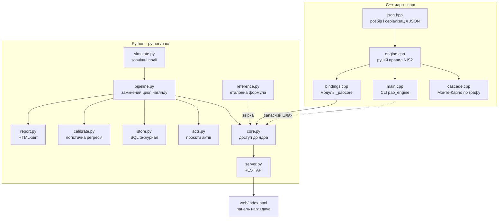
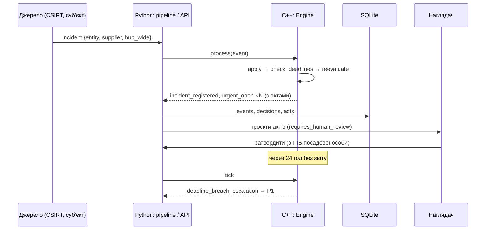

# Архітектура системи PAO

Документ описує будову системи, потоки даних і рішення, ухвалені під час проєктування.

## 1. Огляд

Система складається з трьох шарів. Шари обмінюються лише JSON, тому кожен можна замінити або перевірити окремо.

| Шар | Мова | Відповідальність |
| --- | --- | --- |
| Ядро | C++17 | Детерміновані правила нагляду, індекс ризику, строки, моделювання каскадів |
| Оркестрація | Python 3.9+ | Сценарії, реакція суб'єктів і наглядача, акти, калібрування, сховище, API |
| Інтерфейс | HTML/JavaScript | Панель наглядача поверх REST API |

Ядро не має зовнішніх залежностей: власний парсер JSON (`json.hpp`) і стандартна бібліотека C++17. Python-шар використовує лише стандартну бібліотеку і numpy.

## 2. Компоненти

### 2.1. Ядро (`cpp/`)

| Файл | Призначення |
| --- | --- |
| `include/pao/json.hpp` | Тип `Value` на `std::variant`, рекурсивний парсер RFC 8259 із підтримкою UTF-16 сурогатних пар |
| `include/pao/engine.hpp`, `src/engine.cpp` | `Config`, `Entity`, `Incident`, `Assessment`, клас `Engine` |
| `include/pao/cascade.hpp`, `src/cascade.cpp` | Граф поширення, паралельне моделювання, аналіз «що, як» |
| `src/main.cpp` | Команди `stream`, `assess`, `cascade`, `bench` |
| `src/bindings.cpp` | Python-модуль через pybind11; звільняє GIL під час обчислень |

`Engine::process(event)` — єдина точка зміни стану:

1. Годинник рушія переводиться на час події. Час ніколи не йде назад: запізніла подія приймається, але позначається рішенням `late_event`.
2. `apply` змінює стан відповідно до типу події. Некоректна подія не перериває роботу, а породжує рішення `rejected_event` з причиною.
3. `check_deadlines` фіксує порушення строків звітування, кожне лише один раз.
4. `reevaluate` перераховує оцінку всіх суб'єктів і породжує рішення про зміну рівня та термінову процедуру.

### 2.2. Python-шар (`python/pao/`)

* `core.Engine` дає однаковий інтерфейс над двома способами доступу до ядра: вбудованим модулем `_paocore` і підпроцесом `pao_engine`. Тест `test_cli_and_pybind_agree` перевіряє, що вони дають ідентичні результати.
* `pipeline.run` реалізує замкнений цикл через чергу з пріоритетом (heapq) за часом. Рішення ядра породжують нові події: відповідь суб'єкта на запит і аудит у кінцевий строк.
* `store.Store` веде журнал, у який лише додаються записи. Повторна подача подій із журналу відтворює будь-який стан, що потрібно для судового контролю рішень.

## 3. Потік обробки події

## 4. Модель даних

### Події (вхід ядра)

| `type` | Обов'язкові поля | Дія |
| --- | --- | --- |
| `tick` | `t` | Просування часу; перевірка строків |
| `telemetry` | `entity`, `E` і/або `M` | Оновлення стану захищеності |
| `threat` | `mode`, `level` | Рівень загроз для виду транспорту |
| `incident` | `id`, `entity` | Реєстрація інциденту; запуск годинника ст. 23 |
| `report` | `incident`, `stage` (`early`, `notification`, `final`) | Подання етапу звіту |
| `close` | `incident` | Закриття; потребує остаточного звіту |
| `audit` | `entity`, `outcome` (`confirmed`, `cleared`) | Зворотний зв'язок для калібрування |
| `register` | `entity{…}` | Додавання суб'єкта до реєстру |

### Рішення (вихід ядра)

| `type` | Значення |
| --- | --- |
| `baseline` | Початковий рівень суб'єкта |
| `escalation` / `deescalation` | Зміна рівня; при ескалації додається `act` |
| `urgent_open` / `urgent_close` | Початок і завершення термінової процедури |
| `deadline_breach` | Пропущено етап звітування |
| `incident_registered`, `report_received`, `audit_feedback` | Підтвердження обробки |
| `rejected_event`, `late_event`, `parse_error` | Діагностика вхідних даних |

Об'єкт `act` містить номер, вид акта, захід, кінцевий строк, права суб'єкта, правові підстави, ознаку `requires_human_review` і повну оцінку з поясненням.

## 5. Ключові проєктні рішення

| Рішення | Обґрунтування |
| --- | --- |
| Ядро на C++, оркестрація на Python | Правила виконуються мільйони разів у моделюванні; аналітика й інтеграції простіші в Python |
| Межа шарів через JSON | Ядро можна викликати з будь-якої мови і перевірити незалежно; немає дублювання типів |
| Детермінованість | Генератор випадкових чисел ініціалізується від ідентифікатора вузла, тож результат не залежить від кількості потоків; рішення можна відтворити для суду |
| Подія ніколи не обриває обробку | Помилка вхідних даних стає рішенням `rejected_event`, а не падінням системи |
| Індекс не ухвалює рішень сам | Акти рівнів 3–4 і тимчасові заходи мають `requires_human_review`; API відмовляє в затвердженні без ПІБ |
| Журнал лише з додаванням | Прозорість і можливість перевірити кожне рішення |

## 6. Паралельність і продуктивність

* `Engine` однопотоковий: порядок подій визначає результат, тому паралелізм тут не потрібен. Пропускна здатність ≈ 300 тис. подій/с для реєстру з 14 суб'єктів.
* Моделювання каскадів розподіляє вузли-джерела між потоками через атомарний лічильник. Кожен потік має власний буфер, без спільних змінних. ThreadSanitizer не знаходить гонок даних.
* Складність одного прогону — O(V + E) для графа з V вузлів і E ребер. Повний аналіз — O(V · R · (V + E)) для R прогонів на вузол, плюс аналіз «що, як» для кожного суб'єкта.
